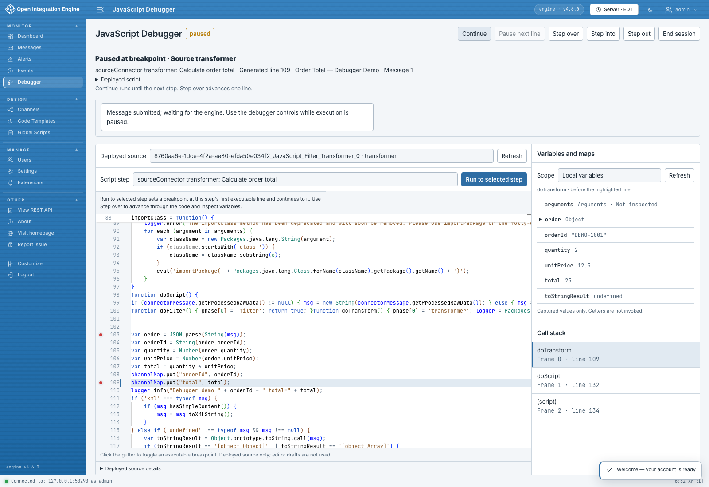

# OIE JavaScript Debugger

Version **1.0.4** supports OIE **4.6.0 and 4.7.0**. See [GitHub Releases](https://github.com/gibson9583/oie-debugger/releases/tag/v1.0.4) for the signed ZIP and release notes.

Debug JavaScript running in Open Integration Engine from Web Administrator. Pause a message, follow the code one line at a time, and inspect its values as it moves through a channel.

Version 1.0.4 enables debugging by default. The debugger screen has an engine-wide **Enable debugger / Disable debugger** control for users with the **Manage JavaScript Debugger** permission. Arming still selects the executions that may pause. Explicit saved settings remain in effect on upgrade.

## What you can do

- Pause at script entry, a breakpoint, a JavaScript `debugger` statement, or an exception.
- Step into, over, and out of JavaScript functions.
- Set a breakpoint at a named script step and continue toward it with **Run to selected step**.
- Read the deployed script and choose a frame in the call stack.
- Inspect variables, message content, XML, and maps.
- Add watches, evaluate expressions, edit variable values, and set conditional breakpoints with evaluation enabled.
- Send a test message through a channel and its enabled destinations.
- Choose a channel, message ID, connector, script kind, or exact deployed source to focus the session.
- Debug global and lifecycle scripts with the appropriate access and session setting.

## Install

Use Java 17 or newer, **OIE 4.6.0 or 4.7.0**, and **Web Administrator with plugin API 4.7 or newer**. Web Administrator 1.0.1 provides this API. The engine also needs web-support endpoints, supplied by the [Web Support extension](https://github.com/gibson9583/oie-web-support-plugin).

1. Download the debugger ZIP from [GitHub Releases](https://github.com/gibson9583/oie-debugger/releases).
2. Install the ZIP through the engine's extension installer.
3. Restart the engine, then reload Web Administrator.
4. Open **Monitor → Debugger**. If an earlier installation saved debugging as disabled, choose **Enable debugger**. The control is at the left of the execution buttons and requires **Manage JavaScript Debugger** permission.
5. Deploy or redeploy the channels you want to debug.

The debugger is enabled by default. Enabling it adds JavaScript observation across the engine, including channels without an armed session. Idle observation reuses scope observers and avoids repeated source-registry locking, but still has a cost. Choose **Disable debugger** to stop observation and release paused executions across the engine. User and channel access restrictions do not limit where observation hooks run.

After upgrading, reload Web Administrator before arming a session so the browser and server use the same command-retry protocol. Explicit saved `enabled=true` and `enabled=false` settings remain in effect on upgrade. Existing roles do not include **Manage JavaScript Debugger**. Grant it to the users who enable or disable debugging.

Version 1.0.4 also guards the engine's generic extension-properties API on OIE 4.6.0 and 4.7.0. While the debugger extension is loaded, those GET/PUT routes require an exact installed extension name; unknown names and trailing-space aliases return 404 before authorization or persistence. Canonical debugger properties require View to read and Manage to change. The guard remains active when debugging is disabled with the debugger control.

The engine's JavaScript setting is `rhino.optimizationlevel=-1`. This is the default when the property is absent from `conf/mirth.properties`. If the property is already present, set its value to `-1` before restarting.

Deploy your test channel with the debugger enabled so its scripts are available. After enabling the debugger for an already running engine, redeploy the channels you want to inspect.

## Debug your first message

1. Open **Monitor → Debugger** and select a test channel.
2. Leave **Message ID** empty for a new message. Select **Break on entry**, then click **Arm debugger**.
3. Under **Send a message**, paste a sample in the format your channel expects and click **Send message**.
4. At the pause, read **Variables and maps** and **Call stack**. If the source has a **Script step** list, select your step and click **Run to selected step**.
5. Use **Step over** to advance through your code, or **Continue** to run to the next stop.
6. Click **End session** when finished. The paused execution resumes.

Keep the Debugger screen open during the session. Each session follows one execution at a time. **Armed** means the debugger is waiting for a matching script, and **paused** means you can inspect the current execution. **Break on entry** can pause at both source and destination scripts.

Choose **Enable evaluation and value editing** before arming to use watches, conditional breakpoints, expression evaluation, and value editing. Expressions run JavaScript with the engine's permissions.

Set **Maximum pause (seconds)** to choose a pause duration from 1 to 120 seconds. The engine resumes processing when that time is reached. It also releases the execution when a disconnected session expires.

## Learn more

The [usage wiki](https://github.com/gibson9583/oie-debugger/wiki) includes installation, a sample channel, sending messages, breakpoints, stepping, inspecting values, permissions, and session recovery. You can also read the [guide in this repository](docs/wiki/Home.md).

Users need **Manage JavaScript Debugger** to enable or disable debugging engine-wide, **View JavaScript Debugger** to read sources, **Control JavaScript Debugger** to run a session, **Evaluate JavaScript Debugger** to use expression features, and **Send Message** to send a sample. Channel permissions and the debugger's extension properties let administrators choose who can debug each channel. See [Access and settings](https://github.com/gibson9583/oie-debugger/wiki/Access-and-settings) for setup steps.

Licensed under the [Mozilla Public License 2.0](LICENSE).
