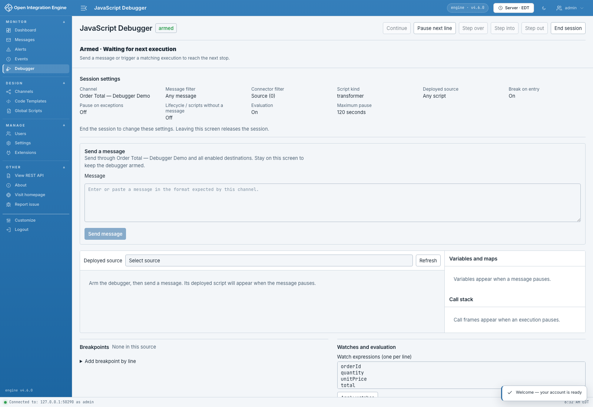

# Debugging a message

This walkthrough follows the order from [Getting started](./Getting-started.md). You will pause in **Calculate order total**, see the input become local variables, and verify that the calculated total reaches the channel map.

## 1. Choose the execution to follow

Open **Monitor → Debugger** and set:

| Setting | Walkthrough value |
| --- | --- |
| Channel | **Order Total — Debugger Demo** |
| Message ID (optional) | Leave empty for the new test message. |
| Connector ID (optional) | Enter `0` to focus on the source connector. |
| Maximum pause (seconds) | `120` |
| Break on entry | Selected |
| Enable evaluation and value editing | Selected, for the expression examples later. |

Expand **Limit the script surface** and enter `transformer` in **Script kind** to focus this run on the source transformer. Keep the remaining options at their defaults, then choose **Arm debugger**. The status changes to **Armed · Waiting for next execution**, and the session settings show the target you selected.



## 2. Send the order

Under **Send a message**, paste:

```json
{"orderId":"DEMO-1001","quantity":2,"unitPrice":12.5}
```

Choose **Send message**. The message follows the channel's normal processing path, including its enabled destinations. In this sample, the destination completes locally.

With **Break on entry** selected, the debugger pauses at the beginning of a matching script. The source pane fills with the deployed JavaScript, and the status identifies the current processing stage and message.

The send status can continue to show a submission in progress while the message is paused. Keep using the debugger controls to advance its execution.

## 3. Go to the transformer step

In **Script step**, select **Calculate order total**, then choose **Run to selected step**. This sets a breakpoint at that step's first executable line and continues toward it.

You can also find `var order = JSON.parse(String(msg));` in **Deployed source**, set a breakpoint beside that line, and choose **Continue**.

The highlighted line is the next line to execute. **Variables and maps** shows the values available before that line.

## 4. Follow the calculation

Choose **Step over** to execute each statement. In **Variables and maps**, select **Local variables** and follow these checkpoints:

| After this statement executes | Value to inspect |
| --- | --- |
| `var order = JSON.parse(String(msg));` | Expand `order` to see the three input fields. |
| `var orderId = String(order.orderId);` | `orderId` is `"DEMO-1001"`. |
| `var quantity = Number(order.quantity);` | `quantity` is `2`. |
| `var unitPrice = Number(order.unitPrice);` | `unitPrice` is `12.5`. |
| `var total = quantity * unitPrice;` | `total` is `25`. |


Paused after calculating `total` and before writing it to `channelMap`.

When the highlighted line has moved past both `channelMap.put(...)` statements, change **Scope** to **Global variables and maps**. Expand `channelMap` to see `orderId` and `total`.

If you select a different entry in **Call stack**, the source and values follow that frame. Select the transformer frame to return to the sample's local variables.

## 5. Evaluate a value

While paused after `quantity` and `unitPrice` have been assigned, enter this in **Evaluate in selected frame**:

```javascript
quantity * unitPrice
```

Choose **Evaluate**. The result is `25`. The [Inspecting values](./Inspecting-values.md) guide shows how to keep expressions in a watch list and try another local value.

## 6. Finish processing

Choose **Continue** to proceed to the next stop. Choose **End session** when you have finished inspecting the message; this releases the paused execution and ends the session.

Check the send result and the engine's message view for the order's processing outcome. The sample's logger statement records `Debugger demo DEMO-1001 total=25`.

For another run, arm the channel again and send a fresh message. Try changing `quantity` to `3`: the same calculation gives `37.5`.

## Pick up an existing message

You can repeat the walkthrough using its completed sample message. This workflow uses the engine's reprocessing permission in addition to your debugger permissions.

1. From the sample message's actions, choose **Debug this message**. The debugger opens with its message and connector target filled in.
2. Select **Break on entry** and arm that target. Keep this Debugger tab open.
3. Open the same engine in a second Web Administrator tab and find the sample message.
4. Choose **Reprocess Message**. In **Reprocessing Options**, select **Overwrite existing messages and update statistics** to keep the original Message ID for this test run. This updates the existing sample message record and its statistics.
5. Choose the destinations for the test and confirm with **OK**.
6. Return to the Debugger tab to inspect the matching execution.

To switch to a fresh test message while an existing-message session is armed or running, choose **Arm for a new message** under the sender. It starts a new session with the Message ID filter cleared and keeps your message draft.

## Continue after an interrupted response

Use **Check arm result** to recover the outcome of the original Arm request, or **Check command result** for a pending execution command. Once an ended session is displayed, choose **Clear session** to return to the target settings and arm again.
