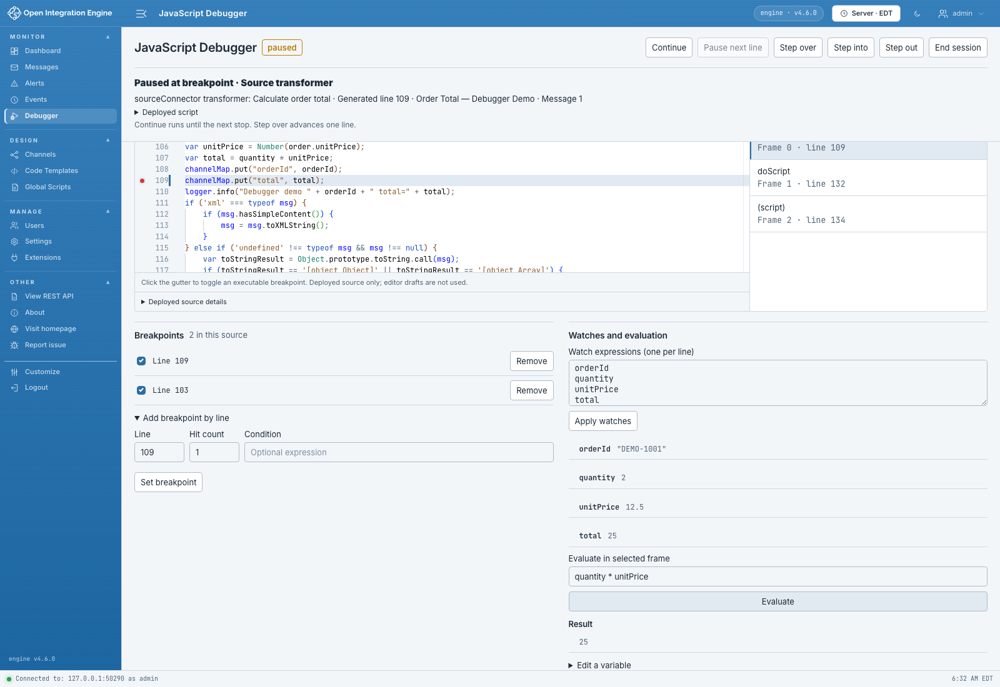

# Inspecting values

At a pause, the debugger captures the values available to the selected call frame. Use those values to understand the current message, compare intermediate results, and check what the next statement will do.

## Read the current values

In **Variables and maps**, choose a **Scope**:

| Scope | What to explore |
| --- | --- |
| **Local variables** | The current function's variables, including intermediate values created by your script. |
| **Global variables and maps** | Values available from the script's top-level scope, including message and map objects. |
| **This object** | The receiver represented by `this` in the selected frame. |

Expand object, array, map, and XML rows to explore their captured contents. Expand a longer text value to read the captured text on multiple lines. Choose **Refresh** to capture the selected frame's values again.

The highlighted source line is about to execute. To inspect a value assigned on that line, choose **Step over**, then look at the next pause.



In the order walkthrough, step past the assignment to `total` and look for `25` under **Local variables**. After the map-write statements execute, choose **Global variables and maps** and expand `channelMap` to compare the stored values.

## Select a call frame

Each entry in **Call stack** represents a JavaScript function or script involved in the paused execution. Select an entry to view its source and captured values.

Use the innermost frame for the current function's local variables. Select a caller to inspect the values that led to the function call. The frame you select also supplies the context for **Evaluate in selected frame** and **Edit a variable**.

## Enable expression tools

Before arming, select **Enable evaluation and value editing**. Your account needs **Evaluate JavaScript Debugger**, along with the View and Control permissions used for a debug session. The installation's `evaluationEnabled` property also needs to be `true`.

Expressions run JavaScript in the paused engine context. Start with expressions that read or calculate values, such as `total`, `quantity * unitPrice`, or a map lookup. Choose an assignment or function call when you intend that expression to change the running test.

## Evaluate an expression

While paused in the sample transformer after the local variables have been assigned, enter an expression in **Evaluate in selected frame** and choose **Evaluate**:

| Expression | Expected sample result |
| --- | --- |
| `orderId` | `"DEMO-1001"` |
| `quantity * unitPrice` | `25` |
| `total === 25` | `true` |
| `channelMap.get("total")` | `25`, after the map-write statement has executed. |

For a particular engine-map entry, evaluate its key directly, for example `sourceMap.get("key")`, using a key relevant to your message. This is a useful way to ask a focused question about an engine object.

## Keep useful expressions in Watches

Enter one expression per line in **Watch expressions (one per line)**:

```javascript
orderId
quantity
unitPrice
total
```

Choose **Apply watches**. The debugger evaluates the list in the selected frame when refreshing a paused inspection and again as new pauses are inspected. At an early pause, step through the assignments to see the watched values become available.

You can prepare the list before arming or change it during an active session. To remove a watch, delete its line and choose **Apply watches** again.

## Try a different local value

Use the sample to explore how an intermediate value affects later statements:

1. Pause after `var total = quantity * unitPrice;` and before `channelMap.put("total", total);`.
2. Select the transformer frame in **Call stack**.
3. Expand **Edit a variable**.
4. Set **Variable name** to `total` and **New value expression** to `30`.
5. Choose **Set value**.
6. Check the updated `total`, then step past `channelMap.put("total", total);`.
7. Inspect `channelMap` or evaluate `channelMap.get("total")` to see `30`.

The edit affects the current execution, so you can follow its result through the rest of that test message. For a lasting change to the calculation, update the transformer step in the channel editor and redeploy it.

For choosing the next pause, see [Breakpoints and stepping](./Breakpoints-and-stepping.md).
